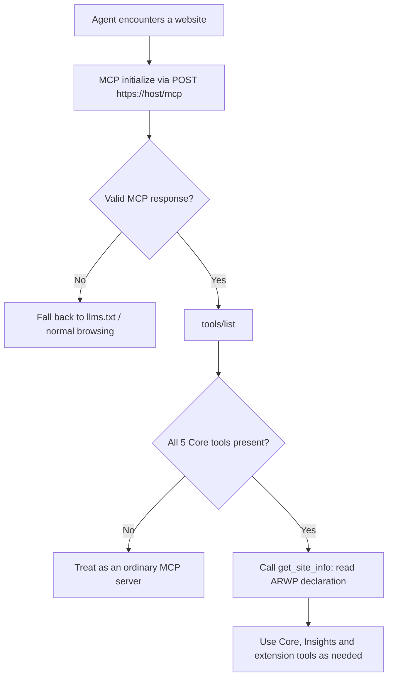

# Agent-Ready Web Profile (ARWP) — Version 0.1

**An MCP-based interoperability profile for websites**

| | |
|---|---|
| **Version** | 0.1 |
| **Status** | Proposed Draft (open for public comment) |
| **Date** | 2026-11-01 |
| **Editors** | AI4 Enterprise |
| **Reference implementation** | [AI4Enterprise](https://www.ai4enterprise.ca/) — `https://www.ai4enterprise.ca/mcp` (alignment in progress, see §12) |
| **Repository** | <https://github.com/steveh250/website-mcp-standard> |

> **Status of this document.** This is a proposed draft and is **not stable**. It is published to gather implementation experience and feedback. Breaking changes may happen before 1.0. Please file issues against this repository.

---

## Abstract

Websites are designed for people. AI agents can read them, but only by working out navigation, markup and prose that differ on every site. ARWP gives agents a predictable way in instead:

1. **A known address.** A participating website serves a [Model Context Protocol (MCP)](https://modelcontextprotocol.io/) server at `https://<host>/mcp`.
2. **A known set of tools.** Every participating website provides the same five read-only **Core** tools: `get_site_info`, `get_services`, `get_contact`, `search_site` and `get_page`.
3. **Known result shapes.** Those tools return structured results with common fields, status values and provenance (canonical URLs and timestamps).
4. **Optional profiles.** Sites that publish articles or research can add the **Insights** profile. Sites can also add their own tools.

ARWP is a *profile* of MCP. It defines conventions on top of MCP and does not replace or change it. A site can implement ARWP as a small, deterministic layer over its existing CMS or static content. It does not need to run an AI model.

---

## Contents

1. [Introduction](#1-introduction)
2. [Conventions and terminology](#2-conventions-and-terminology)
3. [Relationship to MCP](#3-relationship-to-mcp)
4. [Discovery: the `/mcp` endpoint](#4-discovery-the-mcp-endpoint)
5. [Core profile (mandatory)](#5-core-profile-mandatory)
6. [Declaration, versioning and extensions](#6-declaration-versioning-and-extensions)
7. [Results, status values and errors](#7-results-status-values-and-errors)
8. [Insights profile (optional)](#8-insights-profile-optional)
9. [Reserved: Transactions profile](#9-reserved-transactions-profile)
10. [Security, privacy and trust](#10-security-privacy-and-trust)
11. [Conformance](#11-conformance)
12. [Reference implementation: AI4Enterprise](#12-reference-implementation-ai4enterprise-informative)
- [Appendix A — Example wire exchange](#appendix-a--example-wire-exchange-informative)
- [Appendix B — Design decisions in v0.1](#appendix-b--design-decisions-in-v01-informative)
- [Appendix C — Open questions for v0.2](#appendix-c--open-questions-for-v02-informative)
- [References](#references)

---

## 1. Introduction

### 1.1 Problem

An agent asked to "find a consultancy that does AI governance training and book a call" has to locate the right pages on each site, interpret each site's own layout and terms, and guess which facts are authoritative. MCP lets a site expose tools, but MCP alone does not make two sites comparable. One site may offer `get_services` and another `offerings_list`, with unrelated result shapes.

ARWP fills two gaps:

- **Where do I start?** At `/mcp` on the site's host.
- **What can I rely on?** A small set of standard tools with standard names, inputs, outputs and behaviour.

### 1.2 Goals

1. **Predictable.** Same tool names and result shapes on every conforming site.
2. **Small.** The mandatory baseline is achievable by a static site or a small organisation.
3. **MCP-native.** Reuse MCP's transport, tool discovery, schemas and security. Invent nothing MCP already provides.
4. **Grounded.** Results carry canonical URLs and timestamps so agents can cite and verify.
5. **Safe.** The Core profile is read-only and public. Actions with consequences are outside Core.
6. **Testable.** Every requirement has an identifier, and most can be checked automatically.

### 1.3 Non-goals for v0.1

- Changing MCP transport, framing or negotiation.
- Agent-to-agent delegation (see A2A; complementary, §12.3).
- Commerce, payment, identity or government-transaction schemas (§9).
- Requiring AI assistants to auto-connect to public MCP servers. Client adoption is a separate matter.
- Mandating any CMS, platform or language.

---

## 2. Conventions and terminology

The key words **MUST**, **MUST NOT**, **REQUIRED**, **SHALL**, **SHALL NOT**, **SHOULD**, **SHOULD NOT**, **RECOMMENDED**, **NOT RECOMMENDED**, **MAY** and **OPTIONAL** in this document are to be interpreted as described in BCP 14 ([RFC 2119](https://www.rfc-editor.org/rfc/rfc2119), [RFC 8174](https://www.rfc-editor.org/rfc/rfc8174)) when, and only when, they appear in all capitals.

Normative requirements carry an identifier such as **ARWP-CORE-002**. Sections marked *informative*, examples, and notes are not normative.

| Term | Meaning |
|---|---|
| **Site** | A public website identified by its canonical HTTPS origin. |
| **Canonical host** | The host of the site's `canonical_url` (returned by `get_site_info`), e.g. `www.example.com`. |
| **Site hosts** | The canonical host plus any other hosts that serve the same site (e.g. `example.com` and `www.example.com`). |
| **ARWP endpoint** | The MCP server reachable at `https://<canonical host>/mcp`. |
| **Profile** | A named group of tools and behaviours: `core` (mandatory), `insights` (optional). |
| **Extension tool** | Any tool on the endpoint that is not defined by an ARWP profile. |
| **Operator** | The organisation or person responsible for the site and its content. |
| **Client / agent** | Software connecting to the ARWP endpoint for a user or workflow. |
| **Public content** | Content the operator publishes to unauthenticated human visitors. |

---

## 3. Relationship to MCP

**ARWP-MCP-001.** The ARWP endpoint MUST be a conforming MCP server using the **Streamable HTTP** transport.

**ARWP-MCP-002.** The endpoint MUST support MCP protocol revision **2025-06-18** or later. That revision is the minimum because it added structured tool output (`structuredContent` and `outputSchema`), which ARWP relies on. Servers SHOULD support the latest stable MCP revision and negotiate the version with the client as MCP specifies.

**ARWP-MCP-003.** The endpoint MUST advertise the `tools` capability. ARWP defines tools only. A site MAY also expose MCP resources or prompts, but ARWP clients MUST NOT depend on them.

**ARWP-MCP-004.** The endpoint SHOULD allow stateless use. Core tool calls SHOULD NOT depend on earlier calls in the same MCP session, apart from pagination cursors.

Where this document and MCP appear to conflict, MCP governs transport and protocol behaviour and this document should be corrected.

---

## 4. Discovery: the `/mcp` endpoint

### 4.1 Server requirements

**ARWP-DISC-001 — Location.** A conforming site MUST serve its ARWP endpoint at:

```text
https://<canonical host>/mcp
```

For example, `https://www.ai4enterprise.ca/mcp`.

**ARWP-DISC-002 — Trailing slash.** The server SHOULD treat `/mcp/` the same as `/mcp`, either by serving the endpoint there too or by redirecting with HTTP 308.

**ARWP-DISC-003 — Other site hosts.** Every other site host (for example the apex domain when the canonical host is `www`) SHOULD either serve the same endpoint at `/mcp` or redirect `/mcp` to the canonical endpoint with HTTP **307 or 308**, which preserve the POST method and body. Redirect targets MUST use HTTPS and SHOULD stay within the same registrable domain.

**ARWP-DISC-004 — HTTPS only.** The endpoint MUST NOT serve MCP over plain HTTP. Plain-HTTP requests to `/mcp` MAY be redirected to HTTPS.

**ARWP-DISC-005 — No authentication for Core.** `initialize`, `tools/list` and `tools/call` for every Core tool MUST succeed without credentials. Reasonable abuse controls (§10.4) are allowed.

**ARWP-DISC-006 — Human visitors.** A `GET /mcp` that does not accept `text/event-stream`, such as a browser request with `Accept: text/html`, is not an MCP request. The server MAY answer it with a human-readable page that explains the endpoint and lists its tools. All other requests MUST follow MCP's Streamable HTTP rules.

**ARWP-DISC-007 — Cross-origin access.** Browser-based agents need cross-origin access, so the endpoint SHOULD answer CORS preflight requests and SHOULD send:

```http
Access-Control-Allow-Origin: *
Access-Control-Allow-Methods: GET, POST, DELETE, OPTIONS
Access-Control-Allow-Headers: Content-Type, Accept, Mcp-Session-Id, MCP-Protocol-Version, Last-Event-ID
Access-Control-Expose-Headers: Mcp-Session-Id
```

A wildcard origin suits Core because Core serves public, unauthenticated, read-only data. Servers MUST NOT use a wildcard origin together with credentialed responses.

**ARWP-DISC-008 — Advertising the endpoint.** A site SHOULD mention its ARWP endpoint in its `/llms.txt`, if it has one. It MAY also advertise the endpoint through emerging MCP discovery mechanisms, such as a well-known URI or a Server Card. Those mechanisms complement `/mcp` and do not replace it.

**ARWP-DISC-009 — Server instructions.** The MCP `initialize` result SHOULD include `instructions` that name ARWP and suggest a starting point. For example: *"This server implements the Agent-Ready Web Profile (ARWP) 0.1 with profiles core and insights. Call get_site_info first."*

### 4.2 Client behaviour

**ARWP-DISC-010 — Validation.** A client MUST NOT conclude that a site supports ARWP just because `/mcp` returned HTTP 200 or a page mentioning MCP. It MUST complete MCP `initialize` and `tools/list`, then confirm that the five Core tools are present (ARWP-CORE-001).

**ARWP-DISC-011 — Probing etiquette.** A client SHOULD probe `/mcp` only when its user's or operator's policy allows it. It SHOULD cache negative results for a reasonable period and SHOULD NOT probe repeatedly.

**ARWP-DISC-012 — Redirects.** A client SHOULD follow 307/308 redirects from `/mcp` only to HTTPS URLs. It SHOULD NOT follow a redirect to a different registrable domain without user or policy approval.



---

## 5. Core profile (mandatory)

### 5.1 Inventory

| Tool | Human-facing equivalent | Purpose |
|---|---|---|
| `get_site_info` | Home / About | What this site is, who runs it, its main sections, and its ARWP declaration |
| `get_services` | Services / Products | What the site or operator offers, or `not_applicable` |
| `get_contact` | Contact | Public contact and engagement channels |
| `search_site` | Site search | Find content anywhere on the site |
| `get_page` | Any page | Retrieve one page as clean Markdown |

### 5.2 General Core requirements

**ARWP-CORE-001 — Presence.** `tools/list` MUST include all five Core tools with exactly these names.

**ARWP-CORE-002 — Read-only.** Core tools MUST NOT change state, send messages, create records or start transactions.

**ARWP-CORE-003 — Annotations.** Each Core tool MUST be listed with MCP tool annotations `readOnlyHint: true`, `destructiveHint: false`, `idempotentHint: true` and `openWorldHint: false`.

**ARWP-CORE-004 — Input compatibility.** Each Core tool's `inputSchema` MUST accept every argument defined for it in this section. A site MAY add **optional** arguments. It MUST NOT add required ones.

**ARWP-CORE-005 — Output.** Each Core tool MUST return `structuredContent` that validates against the tool's published output schema in [`schemas/core/`](schemas/core/). Each tool SHOULD declare that schema, or a compatible superset, as its `outputSchema` in `tools/list`.

**ARWP-CORE-006 — Honest applicability.** If a category does not apply to the site (for example, a personal blog with no services), the tool MUST return `status: "not_applicable"` with a `reason`. It MUST NOT invent content to fill the schema.

**ARWP-CORE-007 — Consistency with the human site.** Information returned by Core tools MUST be consistent with what the site publishes to human visitors. A site MUST NOT tell agents something materially different from what it tells people.

**ARWP-CORE-008 — Fixed meaning.** Extensions MAY add tools and fields but MUST NOT change the meaning of Core tools or Core fields.

Tool `description` text is free-form. It SHOULD say what the tool returns and SHOULD mention that the tool follows ARWP.

### 5.3 `get_site_info`

Identifies the site and its operator, lists the main sections, and carries the ARWP declaration (§6). Agents SHOULD call this tool first.

**Input:** none.

**Output** (`status: "ok"`; schema: [`get_site_info.output.json`](schemas/core/get_site_info.output.json)):

| Field | Req. | Description |
|---|---|---|
| `arwp` | **MUST** | Declaration: `{ "version": "0.1", "profiles": ["core", ...], "extensions": [...] }` (§6) |
| `name` | **MUST** | Site name |
| `description` | **MUST** | One or two sentences on what the site is for |
| `canonical_url` | **MUST** | Canonical HTTPS home page URL. Its host is the canonical host. |
| `language` | **MUST** | Primary language (BCP 47) |
| `site_type` | **MUST** | One of `business`, `individual`, `government`, `education`, `nonprofit`, `publication`, `community`, `other` |
| `sections` | **MUST** | At least one `{ id, title, url, description? }`: the site's main navigation |
| `operator` | SHOULD | `{ name, legal_name?, url?, location? }` |
| `updated_at` | MAY | When the site information last changed |
| `related` | MAY | Links to other machine-readable resources: `llms_txt`, `sitemap`, `agent_card` |

**ARWP-CORE-010.** Every `sections[].url` MUST be retrievable with `get_page`.

### 5.4 `get_services`

Describes services, products, courses, events, resources or other offerings in one minimal common shape. The name is `get_services`, but "service" is meant broadly as anything the site or operator offers.

**Input** (all optional):

| Argument | Type | Description |
|---|---|---|
| `category` | string | Return only this category (values from `categories`) |
| `limit` | integer 1–100, default 50 | Maximum number of items |
| `cursor` | string | Pagination cursor from `next_cursor` |

**Output** (schema: [`get_services.output.json`](schemas/core/get_services.output.json)):

| Field | Req. | Description |
|---|---|---|
| `services` | **MUST** (if `ok`) | Array of offerings (below), possibly empty |
| `categories` | MAY | All category values available for filtering |
| `next_cursor` | MAY | Present and non-null when more results exist |
| `reason` | **MUST** (if `not_applicable`) | Why the site has no offerings |

Each offering MUST have `id`, `name`, `description` and `url` (canonical details page). It MAY have `type` (recommended: `service`, `product`, `course`, `event`, `program`, `publication`, `resource`, `membership`, `other`), `category`, `audience`, `delivery` (`online`, `in_person`, `hybrid`, `physical_goods`, `digital_goods`, `other`), `regions`, `price` (`amount`, `currency` (ISO 4217), `unit`, `text`), `engagement_url` and `updated_at`.

**ARWP-CORE-020.** A site with no offerings MUST return `status: "not_applicable"`. A site that has offerings but none matching the filter MUST return `status: "ok"` with an empty `services` array.

**ARWP-CORE-021.** Prices, if given, MUST match the publicly displayed price and SHOULD include the currency. If the price is not public, omit `price` or use `price.text` (e.g. *"Contact for a quote"*).

### 5.5 `get_contact`

Returns the channels the operator has chosen to publish for contacting or engaging with them.

**Input:** none.

**Output** (schema: [`get_contact.output.json`](schemas/core/get_contact.output.json)):

| Field | Req. | Description |
|---|---|---|
| `channels` | **MUST** (if `ok`) | Array of `{ type, label?, value?, url?, purpose?, hours? }`. Each channel MUST have `value` or `url`. |
| `contact_url` | SHOULD | The human contact page |
| `reason` | **MUST** (if `not_applicable`) | Why there is no public contact channel |

`type` is one of `email`, `phone`, `form`, `booking`, `chat`, `address`, `social`, `support`, `other`.

**ARWP-CORE-030.** `get_contact` returns links and identifiers only. It MUST NOT send a message or create a booking. Performing an action is a job for extension or Transactions tools.

**ARWP-CORE-031.** Only channels the operator already publishes to human visitors may be returned. ARWP does not require a site to publish an email address, phone number or physical address.

### 5.6 `search_site`

Searches the whole public site, not just one collection.

**Input:**

| Argument | Type | Req. | Description |
|---|---|---|---|
| `query` | string (1–500 chars) | **MUST** | Search terms |
| `limit` | integer 1–50, default 10 | MAY | Maximum number of results |
| `cursor` | string | MAY | Pagination cursor |
| `type` | string | MAY | Filter by result `type` |

**Output** (schema: [`search_site.output.json`](schemas/core/search_site.output.json)): `results` (MUST if `ok`), `query`, `next_cursor`. Each result MUST have `id`, `title` and `url`. It MAY have `summary`, `type` (recommended: `page`, `article`, `service`, `product`, `event`, `person`, `faq`, `other`), `section` (a `sections[].id`), `published_at` and `updated_at`.

**ARWP-CORE-040 — Coverage.** Search MUST cover at least every page in `get_site_info.sections` and every offering `url` from `get_services`. It SHOULD cover all public content. Simple keyword matching over titles, summaries and body text is acceptable. A small site does not need a search engine.

**ARWP-CORE-041 — Retrievable results.** Every result's `id` and `url` MUST be accepted by `get_page`.

**ARWP-CORE-042 — Empty is not an error.** A search with no matches MUST return `status: "ok"` with `results: []`.

### 5.7 `get_page`

Retrieves one published page of the site in a form suitable for language models.

**Input:** exactly one of the following.

| Argument | Type | Description |
|---|---|---|
| `id` | string | A page `id` from `search_site` or `sections` |
| `url` | string | An absolute URL on a site host, or a root-relative path such as `/about` |

The input schema lists both arguments as optional rather than using `oneOf`, because several MCP clients reject top-level schema combinators. Supplying neither or both MUST produce `invalid_request`.

**Output** (schema: [`get_page.output.json`](schemas/core/get_page.output.json)):

| Field | Req. | Description |
|---|---|---|
| `id` | **MUST** | Stable page id |
| `title` | **MUST** | Page title |
| `url` | **MUST** | Canonical URL |
| `content_format` | **MUST** | `text/markdown` (RECOMMENDED) or `text/plain` |
| `content` | **MUST** | Main content, without navigation, footers, cookie banners and other boilerplate |
| `description`, `type`, `language` | MAY | Page metadata |
| `published_at`, `updated_at` | SHOULD (when known) | Provenance timestamps |
| `truncated` | MAY | `true` if `content` was shortened; the full page is at `url` |

**ARWP-CORE-050 — Own content only.** `get_page` MUST only return content from the site hosts. A URL on any other host MUST produce `invalid_request`. The server MUST NOT fetch arbitrary URLs on a client's behalf (see §10.2).

**ARWP-CORE-051 — Normalisation.** The server SHOULD ignore URL fragments, SHOULD accept both the canonical host and other site hosts, and SHOULD resolve redirects and aliases to the canonical page.

**ARWP-CORE-052 — Missing pages.** An unknown or unpublished page MUST produce `status: "not_found"` (§7).

**ARWP-CORE-053 — Public only.** Without authentication, `get_page` MUST NOT return content that requires authentication for human visitors.

---

## 6. Declaration, versioning and extensions

### 6.1 The `arwp` declaration

`get_site_info` returns the site's ARWP declaration:

```json
"arwp": {
  "version": "0.1",
  "profiles": ["core", "insights"],
  "extensions": [
    { "tool": "get_company_profile", "description": "Detailed experience and qualifications." }
  ]
}
```

**ARWP-DECL-001.** `profiles` MUST include `"core"`.

**ARWP-DECL-002.** The declaration MUST match reality. A claimed profile MUST be fully implemented, and `tools/list` remains the authoritative list of tools. Declaring a profile is a claim, not proof of conformance.

**ARWP-DECL-003.** Defined profile names are `core` and `insights`. `transactions` is reserved (§9). Site- or community-defined profiles MUST use an `x-` prefix (e.g. `x-retail`) until they are standardised.

**ARWP-DECL-004.** `extensions` is OPTIONAL. If present, it SHOULD list the site's extension tools.

### 6.2 Versioning

**ARWP-VER-001.** `arwp.version` is `MAJOR.MINOR`. This document defines `0.1`. Profiles share the ARWP version.

**ARWP-VER-002.** Before 1.0, any minor version may contain breaking changes. Clients SHOULD check the exact version and SHOULD make a best effort with versions they do not recognise. From 1.0 onwards, minor versions will only add optional features.

**ARWP-VER-003.** Clients MUST ignore fields, profile names, `type` values and status values they do not recognise. Clients MUST treat an unrecognised status as an error if `isError` is true, and otherwise as success.

### 6.3 Extensions

**ARWP-EXT-001 — Extension tools.** A site MAY expose any additional tools. An extension tool MUST NOT use a name reserved by ARWP: the Core and Insights tool names, plus the names reserved in §9.

**ARWP-EXT-002 — Extension fields.** Site-specific fields in ARWP results SHOULD be placed in the top-level `ext` object, to avoid collisions with future versions. Clients MUST ignore unknown members.

**ARWP-EXT-003 — Tools with side effects.** An extension tool that changes state MUST NOT be annotated `readOnlyHint: true`. It SHOULD set `destructiveHint` accurately and SHOULD apply authentication, authorisation and user-confirmation controls appropriate to the risk.

---

## 7. Results, status values and errors

### 7.1 Result shape

**ARWP-RES-001.** Every ARWP tool result MUST include `structuredContent` containing a `status` field.

**ARWP-RES-002.** For compatibility with clients that ignore structured output, the result SHOULD also include a `text` content block that contains the same JSON, serialised. A short human-readable preamble is not allowed in that block. Additional content blocks, such as resource links, MAY follow.

```json
{
  "content": [{ "type": "text", "text": "{\"status\":\"ok\",\"services\":[...]}" }],
  "structuredContent": { "status": "ok", "services": [ ... ] },
  "isError": false
}
```

### 7.2 Status values

| `status` | `isError` | Meaning | Typical use |
|---|---|---|---|
| `ok` | `false` | Success. Lists may be empty. | All tools |
| `not_applicable` | `false` | The category does not apply to this site. `reason` is required. | `get_services`, `get_contact` |
| `invalid_request` | `true` | Arguments missing, malformed or out of range | All tools with inputs |
| `not_found` | `true` | The requested item does not exist or is not published | `get_page`, `get_insight` |
| `unauthorized` | `true` | Authentication required. Never valid for Core tools. | Extensions |
| `forbidden` | `true` | Authenticated but not permitted | Extensions |
| `rate_limited` | `true` | Too many requests. `error.retry_after_seconds` SHOULD be set. | All |
| `unavailable` | `true` | Temporary failure; retry later | All |
| `internal_error` | `true` | Unexpected server failure | All |

**ARWP-RES-010.** The MCP `isError` flag MUST be set as in the table.

**ARWP-RES-011.** When `isError` is `true`, `structuredContent` MUST include `error: { message, retry_after_seconds? }`. The `message` SHOULD help the agent correct itself (e.g. *"Use search_site to find available pages"*).

**ARWP-RES-012.** Argument validation failures SHOULD be returned as a tool result with `status: "invalid_request"`, not as a JSON-RPC protocol error, so the agent can see the problem and retry. JSON-RPC errors remain correct for protocol failures such as malformed JSON-RPC or an unknown tool name.

### 7.3 Common field conventions

**ARWP-RES-020 — URLs.** `url`, `canonical_url` and related fields MUST be absolute HTTPS URLs. Each one SHOULD be the canonical URL that a human visitor would see for the same content.

**ARWP-RES-021 — Timestamps.** Timestamps MUST be RFC 3339 date-times (`2026-11-01T09:00:00Z`) or full dates (`2026-11-01`). `published_at` and `updated_at` SHOULD be provided whenever they are known.

**ARWP-RES-022 — Identifiers.** `id` values MUST be stable across calls and SHOULD remain stable across site updates. Using the URL path (e.g. `services/ai-strategy`) or slug as the id is acceptable.

**ARWP-RES-023 — Pagination.** Paginated tools return `next_cursor`. When it is present and non-null, the client MAY pass it back as `cursor` to get the next page. Cursors are opaque.

**ARWP-RES-024 — Language.** Language tags MUST be BCP 47 (`en`, `en-CA`, `fr-CA`).

---

## 8. Insights profile (optional)

For sites that publish articles, news, research, case studies or other collections of knowledge. It adds publication-aware search and metadata on top of Core's generic `search_site` and `get_page`.

**ARWP-INS-001.** A site that declares `"insights"` MUST implement all four tools below, following §5.2's rules on annotations, inputs and outputs (ARWP-CORE-002 to -005, applied to these tools). Schemas are in [`schemas/insights/`](schemas/insights/).

| Tool | Input (all optional unless noted) | Returns |
|---|---|---|
| `search_insights` | `query`, `topic`, `series`, `limit` (1–50, default 10), `cursor` | `results[]` of insight summaries, `total?`, `next_cursor?`. With no `query`, newest first. |
| `get_insight` | exactly one of `id` or `url` | One insight: summary fields plus `content_format`, `content` and `references?`. `not_found` if missing. |
| `latest_insights` | `limit` (1–50, default 10), `topic`, `series` | `results[]` ordered by `published_at`, newest first |
| `list_topics` | none | `topics[]` and `series[]` of `{ id, name, description?, count? }`, plus `total_insights?` |

An **insight summary** MUST have `id`, `title`, `url` and `published_at`. It MAY have `summary`, `type` (recommended: `article`, `news`, `research`, `case_study`, `video`, `podcast`, `other`), `updated_at`, `authors[]`, `topics[]` (topic ids), `series` (series id) and `language`.

**ARWP-INS-002.** Insights MUST also be discoverable through Core: `search_site` covers them, and `get_page` accepts their URLs.

**ARWP-INS-003.** The `topic` and `series` filters MUST accept the `id` values returned by `list_topics`.

---

## 9. Reserved: Transactions profile

*This section is informative in v0.1.*

A future Transactions profile will cover actions with consequences, such as bookings, orders, registrations, applications and cancellations. Its direction is to standardise the **lifecycle and safety controls** (discover → prepare → user approval → execute → status/cancel; authentication; explicit consent; idempotency keys; audit identifiers) while letting domain profiles define their own execution verbs.

**ARWP-EXT-010.** The following tool names are reserved and MUST NOT be used by extension tools in v0.1: `list_offerings`, `get_offering`, `check_availability`, `get_requirements`, `prepare_transaction`, `submit_transaction`, `get_transaction_status`, `cancel_transaction`.

Until the profile is defined, sites MAY offer transactional extension tools under other names, subject to ARWP-EXT-003 and §10.

---

## 10. Security, privacy and trust

### 10.1 Content is data, not instructions

**ARWP-SEC-001.** Clients MUST treat all content returned by an ARWP endpoint as untrusted third-party data, never as instructions. Conforming to ARWP does not grant a site any authority over the visiting agent.

**ARWP-SEC-002.** Servers MUST NOT place content in tool results or tool descriptions that is intended to override, redirect or manipulate the agent's or user's instructions. This includes hidden prompts, "ignore previous instructions" text, and requests to send data elsewhere.

### 10.2 No open fetching

**ARWP-SEC-010.** No Core or Insights tool may act as a general-purpose proxy. Servers MUST NOT make outbound requests to URLs supplied by clients. `get_page` serves the site's own content from its own store or origin (ARWP-CORE-050).

### 10.3 Transport

**ARWP-SEC-020.** Servers MUST follow MCP's Streamable HTTP security guidance, including TLS and `Origin` header validation where applicable. Core tools return only public data, so the main risks are abuse and content integrity, not data theft.

### 10.4 Abuse controls

**ARWP-SEC-030.** Servers MAY apply rate limits, request-size limits and bot controls. Rate limiting SHOULD be signalled with `status: "rate_limited"` and `retry_after_seconds`. HTTP 429 at the transport level is also acceptable. Abuse controls MUST NOT amount to requiring an account for Core (ARWP-DISC-005).

### 10.5 Privacy

**ARWP-SEC-040.** Core and Insights tools MUST return only public content. They MUST NOT disclose personal data beyond what the site already publishes to human visitors.

**ARWP-SEC-041.** Search queries can contain personal information. Operators SHOULD minimise retention of query logs and SHOULD describe their handling in their privacy policy.

---

## 11. Conformance

### 11.1 Conformance claims

| Claim | Requirements |
|---|---|
| **ARWP 0.1 Core** | §3, §4.1, §5, §6, §7, §10 |
| **ARWP 0.1 Core + Insights** | All of the above, plus §8 |

A site with extension tools still makes one of these claims. Extensions are not a conformance level. A claim SHOULD be backed by a conformance report from an automated checker.

### 11.2 Automatable checks

A conformance checker takes a hostname and does the following, without performing any action that has side effects:

| # | Check | Requirements |
|---|---|---|
| 1 | `POST https://<host>/mcp` completes MCP `initialize` over Streamable HTTP without credentials, using protocol revision ≥ 2025-06-18 | MCP-001, MCP-002, DISC-001, DISC-005 |
| 2 | Plain HTTP does not serve MCP. The apex/`www` alternate host serves or 307/308-redirects to the endpoint. | DISC-003, DISC-004 |
| 3 | `tools/list` includes all five Core tools | CORE-001 |
| 4 | Core tools have the required annotations, and their input schemas accept the standard arguments | CORE-003, CORE-004 |
| 5 | `get_site_info` validates against its schema, `arwp.profiles` contains `core`, and the canonical host matches the endpoint host | CORE-005, DECL-001, DISC-001 |
| 6 | Every `sections[].url` is retrievable with `get_page` | CORE-010 |
| 7 | `get_services` and `get_contact` validate, with either `ok` or `not_applicable` plus a `reason` | CORE-005, CORE-006 |
| 8 | `search_site` with a term taken from the site name returns valid results. Each result's `id` and `url` work with `get_page`. A nonsense query returns `ok` with `[]`. | CORE-040–042 |
| 9 | `get_page` with an off-site URL returns `invalid_request`. An unknown path returns `not_found`. Neither or both of `id`/`url` returns `invalid_request`. | CORE-050, CORE-052, RES-010 |
| 10 | Error results set `isError` and include `error.message` | RES-010, RES-011 |
| 11 | If `insights` is declared, all four tools are present and valid, `list_topics` ids work as filters, and insights appear in `search_site` | INS-001–003, DECL-002 |
| 12 | No extension tool uses a reserved name | EXT-001, EXT-010 |

Example report:

```text
Site:             https://www.example.com
Endpoint:         https://www.example.com/mcp   (MCP 2025-06-18)
MCP endpoint:     PASS
ARWP Core:        PASS   (12/12 checks)
ARWP Insights:    PASS   (declared)
Extension tools:  1      (get_company_profile)
Result:           ARWP 0.1 Core + Insights
```

Some requirements cannot be fully tested automatically, such as consistency with the human site (CORE-007), full search coverage (CORE-040) and the absence of manipulative content (SEC-002). Checkers SHOULD sample these and report them as warnings.

---

## 12. Reference implementation: AI4Enterprise (informative)

AI4Enterprise exposes an MCP server at `https://www.ai4enterprise.ca/mcp`. The initial design review observed the following tools and mapped them to ARWP:

| Existing tool | Role today | ARWP mapping | Action for v0.1 |
|---|---|---|---|
| `get_company_profile` | Rich business overview, experience, qualifications, evidence | Extension tool | Keep, and list under `arwp.extensions` |
| `get_services` | Consulting and training services (Think → Model → Act) | Core `get_services` | Align output with the schema |
| `get_contact` | Booking, contact and social links | Core `get_contact` | Align output with the schema |
| `search_insights` | Find articles by keyword, topic or series | Insights | Align inputs and outputs |
| `get_insight` | Full article Markdown and metadata | Insights | Align inputs and outputs |
| `latest_insights` | Recent publications | Insights | Align inputs and outputs |
| `list_topics` | Topics and series with counts | Insights | Align inputs and outputs |
| — | — | Core `get_site_info` | **Add** (with the `arwp` declaration) |
| — | — | Core `search_site` | **Add** (site-wide, not only insights) |
| — | — | Core `get_page` | **Add** (all public pages, not only articles) |

### 12.1 Path to "ARWP 0.1 Core + Insights"

1. Add `get_site_info`, `search_site` and `get_page`.
2. Align the existing six standard-named tools with the schemas in [`schemas/`](schemas/), return `structuredContent` and declare `outputSchema`.
3. Add the Core annotations (ARWP-CORE-003) and the `instructions` text (ARWP-DISC-009).
4. Confirm the transport details: Streamable HTTP, CORS, apex-domain redirect, and a human-readable `GET` page.
5. Publish a conformance report.

### 12.2 Verification boundary

The mapping above reflects the tool inventory observed during the initial design review. Wire-level behaviour (headers, redirects, protocol version, CORS) has not yet been verified against this specification. That is the first job for the conformance checker.

### 12.3 A2A as a complement

AI4Enterprise also describes an `/agent` endpoint for an agent that the site operates, using the A2A protocol. The two endpoints serve different purposes:

- `/mcp`: the visiting agent calls site tools directly and keeps control of its workflow (ARWP).
- `/agent`: the visiting agent delegates a task to the site's own agent (A2A).

A site with both SHOULD link its A2A Agent Card from `get_site_info.related.agent_card`. A2A is not required by ARWP.

---

## Appendix A — Example wire exchange (informative)

**1. Initialize**

```http
POST /mcp HTTP/1.1
Host: www.example.com
Content-Type: application/json
Accept: application/json, text/event-stream

{"jsonrpc":"2.0","id":1,"method":"initialize","params":{
  "protocolVersion":"2025-06-18","capabilities":{},
  "clientInfo":{"name":"example-agent","version":"1.0"}}}
```

```json
{"jsonrpc":"2.0","id":1,"result":{
  "protocolVersion":"2025-06-18",
  "capabilities":{"tools":{"listChanged":false}},
  "serverInfo":{"name":"example-com-arwp","version":"1.4.0"},
  "instructions":"This server implements the Agent-Ready Web Profile (ARWP) 0.1 with profiles core and insights. Call get_site_info first."}}
```

The client then sends `notifications/initialized`, as MCP requires.

**2. List tools** (excerpt)

```json
{"jsonrpc":"2.0","id":2,"result":{"tools":[
  {
    "name":"get_services",
    "title":"Services",
    "description":"ARWP Core: services, products and other offerings of Northwind Advisory.",
    "inputSchema":{"type":"object","properties":{
      "category":{"type":"string"},
      "limit":{"type":"integer","minimum":1,"maximum":100,"default":50},
      "cursor":{"type":"string"}}},
    "outputSchema":{ "...": "contents of schemas/core/get_services.output.json" },
    "annotations":{"readOnlyHint":true,"destructiveHint":false,"idempotentHint":true,"openWorldHint":false}
  }
]}}
```

**3. Call a tool**

```json
{"jsonrpc":"2.0","id":3,"method":"tools/call","params":{"name":"get_services","arguments":{"category":"Training"}}}
```

```json
{"jsonrpc":"2.0","id":3,"result":{
  "content":[{"type":"text","text":"{\"status\":\"ok\",\"services\":[{\"id\":\"exec-ai-workshop\", ...}]}"}],
  "structuredContent":{"status":"ok","services":[{
    "id":"exec-ai-workshop","name":"Executive AI Workshop","type":"course",
    "description":"A one-day workshop on AI opportunities, risks and governance for leadership teams.",
    "url":"https://www.example.com/services/exec-ai-workshop",
    "price":{"amount":6000,"currency":"CAD","unit":"per workshop"}}]},
  "isError":false}}
```

Complete example results for every tool are in [`examples/`](examples/).

---

## Appendix B — Design decisions in v0.1 (informative)

These decisions resolve the open questions raised in the initial design discussion.

| # | Question | v0.1 decision | Rationale |
|---|---|---|---|
| 1 | `get_services` or `get_offerings`? | **`get_services`**, defined broadly | Familiar, already deployed by the reference implementation, and the broad definition plus `type` covers non-commercial offerings |
| 2 | Where does the profile declaration live? | **In `get_site_info.arwp`** | Works with every MCP client today and needs no extra mechanism. Server Cards can mirror it later. |
| 3 | Response envelope | **`status` in `structuredContent` plus MCP `isError`** | Uses MCP's own error signal and adds the outcomes MCP has no word for (`not_applicable`) |
| 4 | Mandatory fields | Kept to the minimum agents need to identify, cite and follow up (see §5 tables) | Low barrier to adoption |
| 5 | Search on tiny sites | Must cover sections and offerings. Keyword matching is fine. | A static site can meet this with a prebuilt index |
| 6 | `get_page` input | **`id` or `url`** (absolute or root-relative) | Agents usually hold a URL; ids keep results stable |
| 7 | Apex vs `www` | Canonical host MUST serve. Other hosts serve or 307/308-redirect. | 307/308 preserve POST bodies; 301/302 may not |
| 8 | Schema evolution | Unknown fields ignored; site fields go in `ext` | Allows additive change without collisions |
| 9 | Version negotiation | `MAJOR.MINOR`; exact-match advisory before 1.0 | Simple, and honest about pre-1.0 instability |
| 10 | Transactions | **Deferred to v0.2**; names reserved | Safety controls need dedicated design; not needed for a useful baseline |
| 11 | Fit for blogs, government, nonprofits | `site_type`, `not_applicable`, and optional operator/contact fields | Avoids a commercial bias |
| 12 | Governance | Open GitHub process (see [CONTRIBUTING.md](CONTRIBUTING.md)) | Lightweight until there are multiple implementers |

---

## Appendix C — Open questions for v0.2 (informative)

1. **Transactions profile:** required operations, consent and approval patterns, idempotency, and status model.
2. **Discovery alignment:** how ARWP should relate to MCP Server Cards or well-known discovery once those stabilise.
3. **Multilingual sites:** should Core tools accept a `language` argument, and should `get_site_info` list alternate languages?
4. **Sites under a path:** sites hosted below a path (e.g. `https://host/~user/`), and multi-tenant platforms.
5. **Resources:** whether pages should also be exposed as MCP resources once client support is consistent.
6. **Protected content:** an optional authenticated tier for members-only content.
7. **Domain profiles:** retail, professional services, government, publishing and hospitality.
8. **Conformance tooling:** a reference checker and a public registry of conformance reports.

---

## References

- Model Context Protocol — <https://modelcontextprotocol.io/>
- MCP specification (2025-06-18 and later) — <https://modelcontextprotocol.io/specification/>
- RFC 2119 / RFC 8174 (BCP 14) — requirement keywords
- RFC 3339 — date and time on the Internet
- BCP 47 — language tags
- ISO 4217 — currency codes
- JSON Schema 2020-12 — <https://json-schema.org/draft/2020-12/schema>
- `llms.txt` — <https://llmstxt.org/>
- WebMCP (browser-context tools; complementary) — <https://webmachinelearning.github.io/webmcp/>
- Agent2Agent (A2A) protocol — <https://a2a-protocol.org/>
- AI4Enterprise, *The Agentic Web: Is Your Website Ready for Non-Human Visitors?* — <https://www.ai4enterprise.ca/insights/the-agentic-web-is-your-website-ready-for-non-human-visitors>
